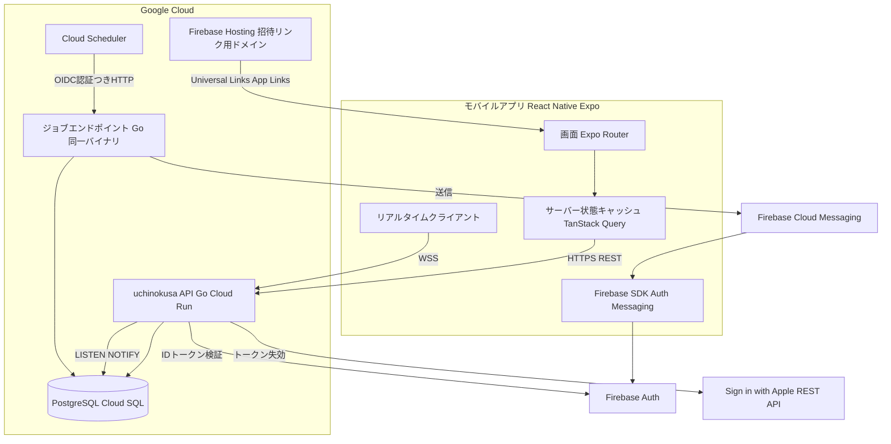
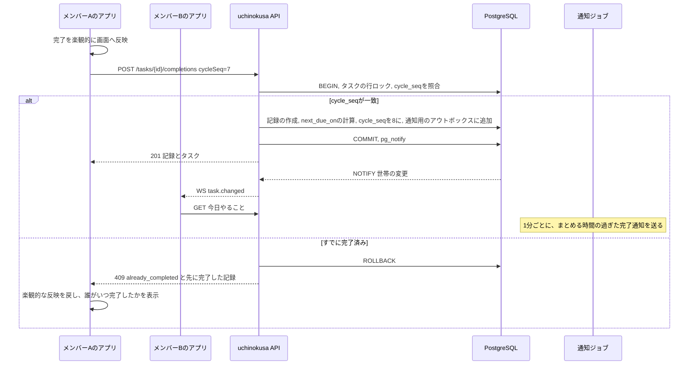
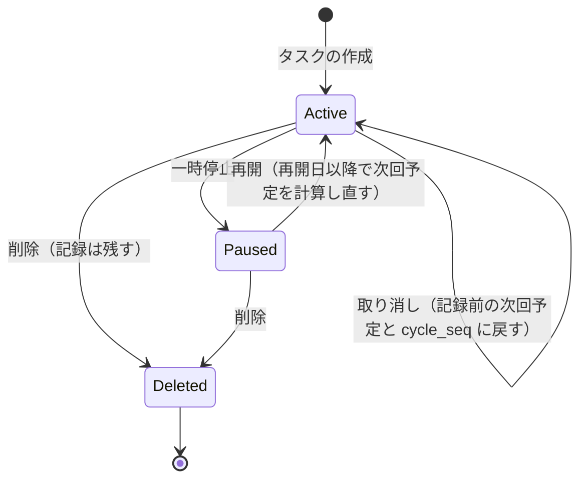
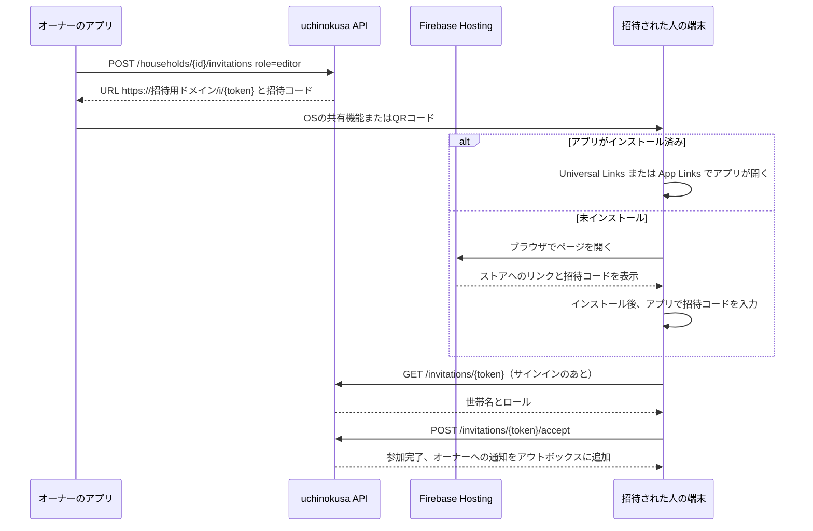
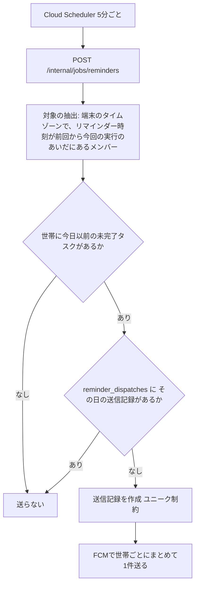
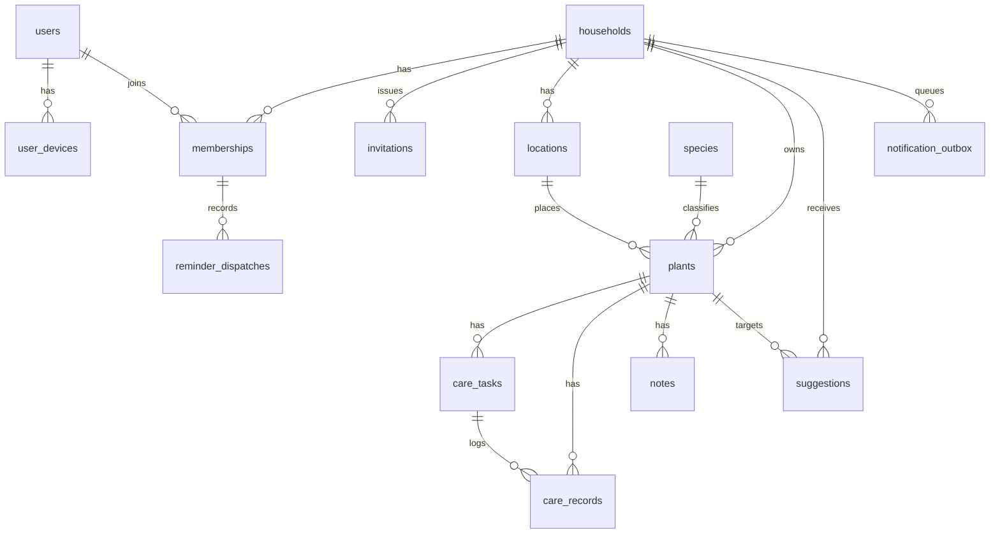

# 技術設計書

## 概要
**目的**：家庭の室内観葉植物を、家族など複数人で上限なく・無料で共同管理できるネイティブアプリ「uchinokusa」のMVPを実現する。お手入れの予定・記録・通知を世帯単位で共有し、リアルタイム同期によって作業の重複を防ぐ。

**利用者**：世帯のオーナー・編集者・閲覧者が、日々の「今日やること」の確認、ワンタップ記録、スキップ判断、植物ごとの履歴・カレンダー・メモの閲覧に使う。開発者は、助言プロバイダの仕組みを通じて、フェーズ2以降の天気連動の助言やAIの機能を追加する。

**位置づけ**：新規開発（グリーンフィールド）である。既存のコードとステアリング文書はない。本設計で選ぶ技術と構成は、設計の承認後に `/kiro:steering` でステアリング文書（`product.md` / `tech.md` / `structure.md`）として残す。

### ゴール
- 世帯単位の植物・タスク・記録の共有と、ロールにもとづく権限制御をサーバー側で保証する
- 「実際に行動した日」を起点に次回予定を計算し、完了の重複をデータベースの制約で防ぐ
- 世帯内の変更を数秒以内に他メンバーへ反映する
- 「やる・やらない・条件つき」の提案を、差し替え可能な助言プロバイダとして扱う
- バックエンド（Go）の学習価値が高い構成でありながら、認証とプッシュ通知の配信はマネージドサービスに任せる

### 対象外
- オフライン時の記録の一時保存と後送
- 通知の細かい設定（まとめずに即時通知するなど）
- 天気と連動した助言（フェーズ2。本設計では差し込み口のみ用意する）
- AIによる識別・診断、肥料の解説、アプリ内での店舗検索、画像の添付
- 有料プランや課金
- 遅延ディープリンク（未インストール時に、インストール後に招待画面へ自動で遷移する仕組み）

## アーキテクチャ

### 全体構成



**構成の考え方**
- **クライアント**：Expo（開発ビルド）で iOS / Android を1つのコードベースで作る。サーバーの状態は TanStack Query で管理する。
- **リアルタイム同期**：WebSocket では「何が変わったか」の通知だけを送る。クライアントは通知を受けて、該当するデータを REST で取り直す（キャッシュの無効化）。データの本体を WebSocket で配らないことで、整合性の管理を REST に一本化する。
- **サーバー**：Go の1つのバイナリで REST API・WebSocket・ジョブを提供する。Cloud Run の複数インスタンス間のイベント配信には、PostgreSQL の `LISTEN/NOTIFY` を使う（Redis を増やさない）。
- **定期処理**：Cloud Scheduler が、認証つきでジョブエンドポイントを定期的に呼ぶ。Cloud Run はリクエストがないとインスタンスが止まるため、プロセス内の常駐タイマーには頼らない。
- **マネージドに任せる範囲**：認証（Firebase Auth）、プッシュ通知の配信（FCM）、招待リンクの検証ファイルの配信（Firebase Hosting）。

### 技術スタック

| 層 | 選定 | 選定理由 | 検討した代替案 |
|---|---|---|---|
| モバイル | React Native + **Expo（開発ビルド + EAS Build）** | React の経験を活かせる。ネイティブ設定を config plugin で管理でき、iOS / Android を同じコードで作れる | Expo Go（ネイティブの Firebase SDK を使えない）、素の React Native CLI（設定の手間が大きい） |
| 画面遷移 | Expo Router | ファイルベースのルーティングとディープリンクを一体で扱える | React Navigation 単体 |
| サーバー状態 | TanStack Query | キャッシュの無効化・楽観的更新・再取得を標準で扱える | Redux Toolkit Query、自前の実装 |
| 認証（クライアント） | `@react-native-firebase/auth` + Apple / Google のサインイン SDK | Apple と Google の資格情報を Firebase の ID トークンに統一できる | Expo の AuthSession のみ |
| プッシュ通知 | `@react-native-firebase/messaging` | iOS / Android ともに FCM トークンを取得でき、サーバー側の送信を FCM に一本化できる | `expo-notifications` + Expo Push Service（Go からの送信が Expo 経由になる） |
| カレンダー | `react-native-calendars` | 月表示とドットによる印を標準で持つ | 自前の実装 |
| QRコード | `react-native-qrcode-svg`（表示）、`expo-camera`（読み取り） | Expo の開発ビルドと相性がよい | — |
| 多言語 | `i18next` + `expo-localization` | 日本語で始め、後から言語を追加できる | 文言の直書き |
| API サーバー | **Go**、標準の `net/http`、**`oapi-codegen`** | OpenAPI の定義から、サーバーのインターフェースと型を生成できる。学習しやすい標準ライブラリ中心の構成 | gin / echo、Connect（gRPC） |
| API 定義 | **OpenAPI 3.1（定義を先に書く）** + `openapi-typescript` | クライアントとサーバーの型を同じ定義から生成でき、項目の追加に強い（要件19-9） | GraphQL、手書きの型 |
| WebSocket | `github.com/coder/websocket` | 保守が続いており、`context` に対応した API を持つ | gorilla/websocket |
| DB | **PostgreSQL 16**（Cloud SQL） | 世帯・メンバー・タスクのような関係データに適し、部分ユニーク制約・JSONB・LISTEN/NOTIFY を使える | Firestore（権限とロジックがセキュリティルールに散らばる）、MySQL |
| DB アクセス | `pgx` + **`sqlc`** | SQL を直接書いて学べ、型安全な Go のコードを生成できる | GORM、ent |
| マイグレーション | `goose` | SQL ファイルで管理でき、Go のバイナリに組み込める | golang-migrate |
| 認証（サーバー） | Firebase Admin SDK for Go（`firebase.google.com/go/v4`） | ID トークンの検証と FCM の送信を1つの SDK で扱える | 自前の JWT 検証 |
| 実行環境 | Cloud Run（API とジョブを1つのサービスで） | WebSocket に対応し、利用が少ないあいだの費用が小さい | Fly.io、GKE |
| 定期実行 | Cloud Scheduler → ジョブエンドポイント（OIDC） | 停止中のインスタンスでも確実に起動できる | Cloud Run Jobs、プロセス内の cron |
| ローカル開発 | Docker Compose（PostgreSQL）、Firebase Auth Emulator | 外部サービスなしで開発・テストができる | — |

**補足**
- Cloud Run の WebSocket 接続は、リクエストのタイムアウト（最大60分）で切れる。クライアントは再接続を前提にし、再接続のたびに表示中のデータを取り直す。
- 家族で使う段階で Cloud SQL の固定費が気になる場合は、Neon などのマネージド PostgreSQL に置き換えられる。アプリのコードは PostgreSQL の標準機能だけに依存させる。
- Firebase Dynamic Links は 2025年8月に終了している。招待リンクには、独自ドメインの Universal Links / App Links を使う。

### 重要な設計判断

#### 判断1：リアルタイム同期は「変更の通知」＋「REST での再取得」にする
- **背景**：要件11-1では、世帯内の変更を数秒以内に反映する必要がある。一方で、整合性の保証（権限、重複の防止、次回予定の計算）はサーバーの一か所に集めたい。
- **代替案**：(a) Firestore のリアルタイムリスナー、(b) WebSocket で変更後のデータ本体を配る、(c) 定期的なポーリング
- **採用**：更新系の API がトランザクションを確定したあと、`pg_notify` で `{世帯ID, エンティティの種類, ID, 操作, 世帯のバージョン}` を発行する。各 API インスタンスはこれを受け取り、その世帯に接続中の WebSocket へ転送する。クライアントは受け取った通知に対応するクエリを無効化して、REST で取り直す。
- **理由**：データの読み出しを権限チェックつきの REST に一本化でき、WebSocket の配信内容に権限の判定を持ち込まずにすむ。メッセージが届かなかった場合も、再接続時の再取得で回復できる。
- **トレードオフ**：変更のたびに REST の往復が1回増える。世帯の規模（数人・数十〜数百株）では問題にならない。

#### 判断2：完了の重複は「サイクル番号」とデータベースの部分ユニーク制約で防ぐ
- **背景**：要件11-2〜11-4では、同じ予定の回に対する完了を1件に限る必要がある。ほぼ同時に押された場合も含む。
- **代替案**：(a) アプリ側のロック、(b) 行ロック（`SELECT ... FOR UPDATE`）だけで防ぐ、(c) 楽観的ロック（タスクのバージョン番号）
- **採用**：タスクは `cycle_seq`（現在の予定の回の番号）を持つ。完了リクエストには、クライアントが見ていた `cycle_seq` を含める。サーバーは、タスクの行ロックを取ったうえで `cycle_seq` を照合する。お手入れ記録には `(task_id, cycle_seq) WHERE outcome='completed' AND is_extra=false` の部分ユニーク制約をかける。重複の場合は `409 already_completed` と、先に完了した記録（誰が・いつ）を返す。ユーザーが明示的に追加の記録を選んだ場合は、`is_extra=true` として保存する。
- **理由**：アプリの不具合やレースがあっても、最終的にデータベースの制約が重複を防ぐ。どの回に対する操作かが明確になり、取り消し（要件10-4）でも元に戻す先がはっきりする。
- **トレードオフ**：完了の API にサイクル番号を渡す必要があり、取り消しの際には番号を戻す処理が必要になる。

#### 判断3：提案は「助言プロバイダ」のインターフェースと、提案テーブルで扱う
- **背景**：要件17・19では、MVPの植え替えの提案と、将来の天気連動・AIによる提案を同じ流れ（表示・採用・見送り・記録）で扱う必要がある。提案の種類は「実施をすすめる・やらない方がよい・条件つき」の3つである。
- **代替案**：(a) 機能ごとに個別の API とテーブルを作る、(b) ルールエンジンを導入する
- **採用**：Go の `Advisor` インターフェース（後述）を定義し、プロバイダをレジストリに登録する。プロバイダが返した提案は、`suggestions` テーブルに保存する（`provider_id`、`kind`、`action`、`reason`、有効期間、`dedupe_key`、ユーザーの対応）。評価のきっかけは、(1) イベント（植物の登録、タスクの予定日の変更）と、(2) 日次のジョブ（MVPでは空。フェーズ2で天気連動のプロバイダを追加する）の2つとする。
- **理由**：提案の表示と採用・見送りの流れが、プロバイダの種類に依存しない。`dedupe_key` によって、見送られた提案を繰り返し出さないこと（要件17-6）を共通の仕組みで保証できる。
- **トレードオフ**：MVPのプロバイダは1つ（植え替え）だけなので、仕組みとしてはやや過剰になる。これはフェーズ2に向けた意図的な先行投資である。

## システムフロー

### タスクの完了（重複の防止とリアルタイム反映）



### お手入れタスクの状態と次回予定の計算



**次回予定の計算ルール**（ドメイン層の純粋な関数として実装する）
- **完了**：`次回予定 = 実施日 + 周期(実施日の季節)`。周期の単位が月の場合、月末は丸める（例：1/31 + 1か月 = 2/28 または 2/29）。
- **スキップ**：`次回予定 = 確認日`（初期値は翌日。ユーザーが変更できる）。`cycle_seq` は進めない。スキップした回に、あとから完了できる。
- **予定日の手動変更**：指定された日を次回予定にする。`cycle_seq` は変えない。
- **季節の切り替え**（要件8-7）：日次のジョブが季節の初日に、季節ごとの周期を持つ有効なタスクについて `次回予定 = max(最終完了日 + 新しい季節の周期, 今日)` で計算し直す。手動で変更した予定日には `due_overridden=true` を立て、計算し直しの対象から外す。
- **季節の定義**（初期値・北半球）：春 3〜5月、夏 6〜8月、秋 9〜11月、冬 12〜2月。世帯の `hemisphere` で切り替えられる構造にする。

### 招待と参加



### リマインダーの送信（定期ジョブ）



## 要件のトレーサビリティ

| 要件 | 概要 | 主なコンポーネント | 主なインターフェース・フロー |
|---|---|---|---|
| 1 | サインイン・サインアウト・アカウント削除 | AuthMiddleware、AccountService、AppleRevoker、クライアントの AuthProvider | `PUT /me`、`DELETE /me`、`POST /me/devices` |
| 2 | 世帯の作成・切り替え・退出・削除 | HouseholdService | `/households` 系 |
| 3 | 招待リンク・QRコード・参加 | InvitationService、Firebase Hosting | 招待フロー、`/invitations` 系 |
| 4 | ロールと権限 | Authorizer（ポリシー表）、MembershipService | すべての API。`403` / `404` |
| 5 | 植物の登録・一覧・アーカイブ | PlantService | `/households/{id}/plants` 系 |
| 6 | 植物マスタ | SpeciesService | `GET /species?q=` |
| 7 | 置き場所・世帯の地域 | LocationService、HouseholdService | `/households/{id}/locations` 系 |
| 8 | 周期・実行条件・季節ごとの周期・一時停止 | CareTaskService、ScheduleCalculator、SeasonJob | `/plants/{id}/tasks` 系、タスクの状態図 |
| 9 | 今日やること一覧・やらない方がよい表示 | TodayQuery、SuggestionService | `GET /households/{id}/today` |
| 10 | 完了・スキップ・取り消し・まとめて完了 | CareRecordService、ScheduleCalculator | `/tasks/{id}/completions`、`/skips`、`/records/{id}/undo`、`/completions:batch` |
| 11 | 重複の防止・リアルタイム同期 | CareRecordService、ChangeBroadcaster、RealtimeHub | 完了のシーケンス図、`GET /ws` |
| 12 | 履歴 | CareRecordQuery | `GET /plants/{id}/records` |
| 13 | メモ | NoteService | `/plants/{id}/notes` 系 |
| 14 | カレンダー | CalendarQuery | `GET /plants/{id}/calendar?month=` |
| 15 | リマインダー | ReminderJob、NotificationSettings、FCMSender | リマインダーのフロー |
| 16 | 完了通知とまとめ送信 | NotificationOutbox、CompletionNotifyJob | 完了のシーケンス図 |
| 17 | 植え替えの簡易レコメンド | RepottingAdvisor、SuggestionService | `/suggestions/{id}/accept`、`/dismiss` |
| 18 | 園芸店を探す | クライアントの MapLauncher | OS の URL スキーム |
| 19 | 拡張に備えた構造 | Advisor インターフェース、AdvisorRegistry、各テーブルの `attributes` 列 | 判断3 |
| 20 | 非機能要件 | 全体（TLS、Authorizer、楽観的更新、i18n、バックアップ） | セキュリティ・性能の節 |

## コンポーネントとインターフェース

### サーバーの構成（Go）
レイヤーを分けたシンプルな構成（ヘキサゴナルの考え方を軽く取り入れたもの）とする。ドメイン層は外部への依存を持たない。

```
cmd/uchinokusa/            エントリーポイント（serve / migrate / seed のサブコマンド）
internal/domain/           エンティティ、値オブジェクト、ScheduleCalculator、季節の判定（純粋なロジック）
internal/app/              ユースケース（各 Service）、Authorizer、トランザクションの境界
internal/advisor/          Advisor インターフェース、レジストリ、RepottingAdvisor
internal/adapter/http/     oapi-codegen で生成したハンドラーの実装、ミドルウェア
internal/adapter/ws/       RealtimeHub（WebSocket の接続管理）
internal/adapter/postgres/ sqlc で生成したクエリ、リポジトリの実装、LISTEN/NOTIFY
internal/adapter/firebase/ ID トークンの検証、FCM の送信
internal/adapter/apple/    Sign in with Apple のトークン失効
internal/job/              ReminderJob、CompletionNotifyJob、SeasonJob、AdvisorDailyJob
api/openapi.yaml           API 定義（唯一の正）
db/migrations/             goose の SQL ファイル
db/queries/                sqlc の SQL ファイル
db/seeds/                  植物マスタの初期データ
```

### 横断的なコンポーネント

#### AuthMiddleware
- **責務**：`Authorization: Bearer <Firebase ID トークン>` を検証し、`firebase_uid` から `users` の行を特定して、リクエストのコンテキストに入れる。初めてのユーザーの場合は `users` の行を作る。
- **依存**：Firebase Admin SDK（公開鍵はキャッシュされる）
- **エラー**：トークンがない、無効、期限切れの場合は `401 unauthenticated`（要件1-3）

#### Authorizer
- **責務**：`(ロール, 操作)` のポリシー表にもとづいて、操作を許可するかどうかを判定する（要件4-1、4-2）。パスに含まれる `householdId`、または対象のリソースから世帯を特定し、`memberships` を参照する。
- **規約**：世帯のメンバーでない場合は、存在を明かさないために `404 not_found` を返す（要件4-4）。メンバーだがロールが足りない場合は `403 forbidden` を返す（要件4-3）。

```go
type Role string // "owner" | "editor" | "viewer"

type Action string // "household.manage", "invite.manage", "member.manage",
                   // "plant.write", "task.write", "record.write", "note.write", "read", "settings.self"

type Authorizer interface {
    // 世帯のメンバーであることと、ロールが操作を許可することを検証し、メンバーシップを返す
    Require(ctx context.Context, userID, householdID uuid.UUID, action Action) (Membership, error)
}
```

**ポリシー表**

| 操作 | オーナー | 編集者 | 閲覧者 |
|---|---|---|---|
| `household.manage` / `invite.manage` / `member.manage` | ○ | — | — |
| `plant.write` / `task.write` / `record.write` / `note.write`（置き場所を含む） | ○ | ○ | — |
| `read` / `settings.self` | ○ | ○ | ○ |

メモの編集・削除は、`note.write` に加えて「作成者本人、またはオーナー」であることを確認する（要件13-3）。

#### ChangeBroadcaster と RealtimeHub
- **ChangeBroadcaster**：Service がトランザクション内で `ChangeEvent` を登録する。コミットしたあとに `pg_notify('household_changes', json)` を発行する。世帯の `version`（単調に増える番号）を同じトランザクションで1つ増やす。
- **RealtimeHub**：PostgreSQL への専用接続で `LISTEN household_changes` し、届いたイベントを `householdID → 接続の集合` に配る。
- **接続**：`GET /ws?token=<ID トークン>`。接続後、クライアントは `subscribe {householdIds}` を送る。Hub は各世帯への所属を確認してから購読させる。ロールの変更や、メンバーの削除を受けた場合は、購読を見直す（要件4-6、4-7）。
- **ハートビート**：30秒ごとに ping を送る。クライアントは切断を検知したら、指数バックオフで再接続し、再接続後に購読中の世帯のクエリをすべて無効化する（要件11-5）。

**イベントの取り決め**（WebSocket で送るメッセージ）

```typescript
type RealtimeMessage =
  | { type: "changed"; householdId: string; version: number;
      entity: "plant" | "location" | "task" | "record" | "note" | "member" | "household" | "suggestion";
      entityId: string; op: "created" | "updated" | "deleted"; actorUserId: string; plantId?: string }
  | { type: "membership_revoked"; householdId: string }
  | { type: "role_changed"; householdId: string; role: "owner" | "editor" | "viewer" }
  | { type: "pong" };
```
- **配信**：「最大1回」とする。取りこぼしは、再接続時の再取得と、`version` の飛び（受け取った番号が手元の番号より2つ以上大きい）を検知したときの再取得で回復する。
- **順序**：世帯ごとに `version` の順で処理する。古い `version` は無視する。

### ドメインのコンポーネント

#### ScheduleCalculator（`internal/domain`）
- **責務**：次回予定の計算、季節の判定、植え替えの適期の判定を行う。すべて副作用のない純粋な関数とする。

```go
type IntervalUnit string // "day" | "week" | "month"

type Interval struct {
    Value int          // 1以上
    Unit  IntervalUnit
}

type Season string // "spring" | "summer" | "autumn" | "winter"

type SeasonalIntervals map[Season]Interval // 空なら基本の周期を使う

type ScheduleCalculator interface {
    SeasonOf(date civil.Date, hemisphere Hemisphere) Season
    EffectiveInterval(base Interval, seasonal SeasonalIntervals, on civil.Date, h Hemisphere) Interval
    NextDueAfterCompletion(performedOn civil.Date, base Interval, seasonal SeasonalIntervals, h Hemisphere) civil.Date
}
```
- **事後条件**：`NextDueAfterCompletion` は、常に `performedOn` より後の日を返す。

#### CareTaskService
- **責務**：お手入れタスクの作成・更新・一時停止・再開・削除（要件8）を扱う。
- **ルール**：
  - 種類が `other` の場合だけ `custom_name` を必須にする。
  - 植物が植物マスタと紐づいている場合、作成画面の初期値として、マスタの `recommended_care` から推奨周期と推奨の実行条件を返す（要件6-4）。
  - 予定日が手動で変更されたとき、植え替えタスクであれば `SuggestionService.EvaluateForEvent(TaskDueChanged)` を呼ぶ（要件17-8）。

#### CareRecordService
- **責務**：完了・スキップ・取り消し・まとめて完了、および記録の編集・削除（要件10、11-2〜11-4、12-4）を扱う。

```go
type CompleteInput struct {
    TaskID      uuid.UUID
    CycleSeq    int        // クライアントが見ていた予定の回
    PerformedOn civil.Date // 省略時はリクエストした人の端末での今日
    AllowExtra  bool       // 重複を承知のうえで追加として記録する
}

type SkipInput struct {
    TaskID     uuid.UUID
    CycleSeq   int
    ReasonCode SkipReason // "soil_wet" | "bad_weather" | "plant_weak" | "other" | ""
    ReasonText string     // ReasonCode が other のとき（200文字以内）
    RecheckOn  *civil.Date // 省略時は翌日
}

type CareRecordService interface {
    Complete(ctx context.Context, actor Actor, in CompleteInput) (CareRecord, CareTask, error)
    CompleteBatch(ctx context.Context, actor Actor, in []CompleteInput) ([]BatchResult, error)
    Skip(ctx context.Context, actor Actor, in SkipInput) (CareRecord, CareTask, error)
    Undo(ctx context.Context, actor Actor, recordID uuid.UUID) (CareTask, error)
    Update(ctx context.Context, actor Actor, recordID uuid.UUID, performedOn civil.Date) (CareRecord, CareTask, error)
    Delete(ctx context.Context, actor Actor, recordID uuid.UUID) (CareTask, error)
}
```
- **トランザクションの境界**：1件の完了・スキップは、1つのトランザクションで処理する（タスクの行ロック → 照合 → 記録の作成 → タスクの更新 → アウトボックスへの追加 → 変更イベントの登録）。
- **取り消しの条件**：記録した本人が、作成から10分以内に、そのタスクの最新の記録である場合に限る。記録には `prev_next_due_on` と `prev_cycle_seq` を保存しておき、取り消すときはそこに戻す。アウトボックスで未送信の完了通知は、取り消し済みにする（要件16-6）。
- **まとめて完了**：タスクごとに独立したトランザクションで処理し、結果（成功・重複・エラー）をタスクごとに返す。
- **編集・削除**（要件12-4）：対象がそのタスクの「最新の完了記録」であれば、残っている最新の完了記録の実施日から、次回予定を計算し直す。

#### SuggestionService と Advisor（`internal/advisor`）
- **責務**：プロバイダを呼び出し、提案を保存し、採用・見送りを処理する。

```go
type SuggestionKind string   // "do" | "avoid" | "conditional"
type SuggestionAction string // "create_task" | "skip_today" | "info"

type AdviceTrigger string // "plant_created" | "task_due_changed" | "daily"

type AdviceContext struct {
    Trigger     AdviceTrigger
    Today       civil.Date
    Household   HouseholdProfile  // 地域、半球、タイムゾーン
    Plant       PlantProfile      // 種類、購入日、置き場所
    Species     *SpeciesProfile   // 植物マスタ（紐づかない場合は nil）
    Location    *LocationProfile
    Tasks       []CareTaskSnapshot
    RecentLogs  []CareRecordSnapshot // スキップの理由を含む
}

type ProposedSuggestion struct {
    Kind          SuggestionKind
    Action        SuggestionAction
    TaskKind      *CareKind        // create_task の場合の作業の種類
    TargetTaskID  *uuid.UUID       // avoid、conditional の対象
    ProposedDate  *civil.Date
    ConditionText string           // conditional の場合の「もし〜なら」
    Message       string           // 表示する本文（i18n のキーとパラメーター）
    Reason        string           // 理由（i18n のキーとパラメーター）
    ValidFrom     civil.Date
    ValidUntil    *civil.Date
    DedupeKey     string           // 例: "repotting:initial:{plantID}"
}

type Advisor interface {
    ID() string                      // 例: "repotting.v1"
    Triggers() []AdviceTrigger
    Advise(ctx context.Context, in AdviceContext) ([]ProposedSuggestion, error)
}

type SuggestionService interface {
    EvaluateForEvent(ctx context.Context, trigger AdviceTrigger, plantID uuid.UUID) ([]Suggestion, error)
    Accept(ctx context.Context, actor Actor, suggestionID uuid.UUID, overrideDate *civil.Date) (Suggestion, *CareTask, error)
    Dismiss(ctx context.Context, actor Actor, suggestionID uuid.UUID) (Suggestion, error)
    ListActive(ctx context.Context, householdID uuid.UUID, on civil.Date) ([]Suggestion, error)
}
```
- **不変条件**：`(household_id, dedupe_key)` はユニークとする。いったん見送られた `dedupe_key` は、二度と作られない（要件17-6）。
- **プロバイダの障害**：個々のプロバイダのエラーは記録したうえで握りつぶし、元の操作（植物の登録など）は失敗させない。

#### RepottingAdvisor（MVPのプロバイダ）
- **きっかけ**：`plant_created`（購入日があり、植え替えタスクがない場合）、`task_due_changed`（植え替えタスクの予定日が変更された場合）
- **ルール**（設定値はコード内の定数とし、将来は設定テーブルへ移す）
  - 慣らし期間：14日
  - 適期：4〜6月、9月
  - 避ける時期：7〜8月、12〜2月
  - 提案日：`max(購入日 + 14日, 今日)` 以降で、最初に適期に入る日（同じ月の中ならその日、そうでなければ次の適期の月の1日）
- **出力**
  - `plant_created`：`kind=do, action=create_task, taskKind=repotting`。理由の例：「慣らし期間のあと、真夏を避けた最初の適期です」（要件17-7）
  - `task_due_changed`（予定日が避ける時期に入る場合）：`kind=avoid, action=info`。本文の例：「この時期の植え替えは株を傷めやすい」。設定自体は妨げない（要件17-8）

#### TodayQuery
- **責務**：今日やること一覧を返す（要件9）。
- **ルール**：
  - 対象は、`status=active` かつ `next_due_on <= 今日` のタスクで、植物がアーカイブされていないもの。
  - 「今日」は、クライアントが `?date=YYYY-MM-DD` で渡す端末での日付とする。
  - 各タスクに、`期限切れの日数`、`実行条件`、有効な `avoid` / `conditional` の提案を添える。
  - 未完了のタスクがない場合は、直近の次の予定を1件返す（要件9-6）。

### 通知とジョブ

#### NotificationOutbox と CompletionNotifyJob（要件16）
- **アウトボックス**：完了を記録したトランザクションの中で、`notification_outbox` に `{kind: completion, household_id, actor_user_id, record_id, status: pending}` を追加する。参加の通知（要件3-8）も同じ仕組みで送る。
- **ジョブ**：1分ごとに実行する。作成から60秒以上たった `pending` を、`(世帯, 作業した人)` ごとにまとめる。受信者は、完了通知が有効なメンバーのうち、作業した本人を除いた人とする（要件16-1〜16-3）。まとめた通知を1件、FCM で送る（要件16-4）。
  - 1件の場合の例：「〇〇さんがモンステラに水やりしました」
  - 複数件の場合の例：「〇〇さんが3件のお手入れをしました（水やり2件、肥料1件）」
- **取り消し済み**の行は `canceled` とし、送らない（要件16-6）。スキップはアウトボックスに入れない（要件16-7）。
- **冪等性**：行を `FOR UPDATE SKIP LOCKED` で取得し、送信後に `sent` にする。FCM の一時的なエラーは、最大3回まで次回の実行で再送する。

#### ReminderJob（要件15）
- **きっかけ**：Cloud Scheduler から5分ごとに呼ばれる。
- **抽出**：`user_devices.time_zone`（端末の IANA タイムゾーン。アプリの起動時に更新する）での現在時刻が、`memberships.reminder_time` の時刻を過ぎていて、その日の送信記録がないメンバーを抽出する。
- **判定**：その世帯に、端末での今日以前の未完了タスク（有効かつアーカイブされていない植物のもの）がなければ送らない（要件15-4）。閲覧者も対象とする（要件15-8）。
- **冪等性**：`reminder_dispatches (membership_id, local_date)` のユニーク制約で、1日1回を保証する（要件15-2）。
- **送信内容**：世帯名、件数、内容の概要（例：「水やり3件・肥料1件」）。データとして `householdId` を入れ、タップすると今日やること一覧へ遷移する（要件15-5）。
- **無効なトークン**：FCM が `UNREGISTERED` を返した端末のトークンは削除する。

#### SeasonJob / AdvisorDailyJob
- **SeasonJob**：毎日実行する。季節の初日にだけ、季節ごとの周期を持つタスクの次回予定を計算し直す（要件8-7）。
- **AdvisorDailyJob**：毎日実行する。`daily` をきっかけに持つプロバイダを呼ぶ。MVPでは該当するプロバイダはない（フェーズ2で天気連動のプロバイダを追加する）。

**ジョブの共通の取り決め**
- エンドポイントは `/internal/jobs/*` とし、Cloud Scheduler のサービスアカウントによる OIDC トークンで認証する。外部からは呼べないようにする。
- 実行のたびに処理件数と所要時間をログに出す。二重に起動されても、ユニーク制約とロックで結果が変わらないようにする。

### アカウント（要件1）

#### AccountService と AppleRevoker
- **初回のサインイン**：`users` の行を作り、表示名の初期値をプロバイダから受け取った名前にする（要件1-2）。
- **端末の登録**：`POST /me/devices {fcmToken, platform, timeZone}`。サインアウト時は `DELETE /me/devices/{id}` を呼ぶ（要件1-5）。
- **アカウントの削除**（`DELETE /me`）：
  1. ほかにメンバーのいる世帯の唯一のオーナーである場合は、`409 owner_transfer_required` と対象の世帯の一覧を返す（要件1-7）。
  2. Apple でサインインしたユーザーの場合、クライアントは削除の直前に Apple で再認証し、認可コードを送る。サーバーは、Sign in with Apple REST API でトークンを取得し、失効させる。
  3. 自分だけがメンバーの世帯は、関連データごと削除する。それ以外の世帯からは、メンバーシップを外す。
  4. お手入れ記録とメモの作成者は「退会したユーザー」として匿名化する（個人情報を削除するため）。
  5. 端末を削除し、Firebase Auth のユーザーを削除する。
- **メンバーの削除・退出との違い**：アカウントの削除ではない場合、記録の作業者名（スナップショット）は残す（要件4-7、12-5）。

### API の取り決め（抜粋）
- ベースパスは `/v1` とする。JSON の項目名はキャメルケース、日付は `YYYY-MM-DD`、日時は RFC 3339（UTC）とする。
- 定義は `api/openapi.yaml` を唯一の正とし、Go のサーバーのインターフェースと TypeScript の型を生成する。
- 互換性のルール（要件19-9）：
  - 項目の追加だけを許可する。削除や意味の変更は `/v2` で行う。
  - クライアントは、知らない項目と知らない列挙値を無視する。
  - 列挙値には、将来の値を受け入れられる `unknown` の扱いをクライアント側に用意する。

| メソッド | パス | 概要 | 主なエラー |
|---|---|---|---|
| GET / PUT | `/me` | プロフィール・表示名 | 401 |
| DELETE | `/me` | アカウントの削除 | 409 owner_transfer_required |
| POST / DELETE | `/me/devices`、`/me/devices/{id}` | プッシュ通知の送信先・タイムゾーン | 400 |
| GET / POST | `/households` | 所属する世帯の一覧、作成 | 400 |
| PATCH / DELETE | `/households/{hid}` | 世帯名・地域の変更、削除 | 403、404 |
| GET | `/households/{hid}/members` | メンバーの一覧 | 404 |
| PATCH / DELETE | `/households/{hid}/members/{uid}` | ロールの変更、削除・退出 | 403、409 last_owner |
| POST | `/households/{hid}/ownership-transfer` | オーナー権限の移譲 | 403、422 |
| PUT | `/households/{hid}/members/me/notification-settings` | リマインダーの有効・時刻、完了通知 | 400 |
| GET / POST | `/households/{hid}/invitations` | 招待の一覧、作成 | 403 |
| DELETE | `/households/{hid}/invitations/{iid}` | 招待の取り消し | 403 |
| GET | `/invitations/{tokenOrCode}` | 招待の内容（世帯名・ロール） | 410 invitation_invalid |
| POST | `/invitations/{tokenOrCode}/accept` | 参加 | 409 already_member、410 |
| GET / POST | `/households/{hid}/locations` | 置き場所 | 403 |
| PATCH / DELETE | `/locations/{lid}` | 置き場所の更新・削除 | 403、404 |
| GET / POST | `/households/{hid}/plants` | 一覧（`?locationId=&q=&archived=`）、登録 | 403 |
| GET / PATCH / DELETE | `/plants/{pid}` | 詳細、更新、削除 | 403、404 |
| POST | `/plants/{pid}/archive`、`/unarchive` | アーカイブ | 403 |
| GET / POST | `/plants/{pid}/tasks` | タスクの一覧、作成 | 403、422 |
| PATCH / DELETE | `/tasks/{tid}` | 周期・実行条件・予定日の変更、削除 | 403、404 |
| POST | `/tasks/{tid}/pause`、`/resume` | 一時停止、再開 | 403 |
| POST | `/tasks/{tid}/completions` | 完了 | 409 already_completed |
| POST | `/households/{hid}/completions:batch` | まとめて完了 | 207 相当の個別結果 |
| POST | `/tasks/{tid}/skips` | スキップ | 409 stale_cycle |
| POST | `/records/{rid}/undo` | 取り消し | 409 undo_expired |
| PATCH / DELETE | `/records/{rid}` | 記録の編集・削除 | 403 |
| GET | `/plants/{pid}/records` | 履歴（`?kind=&cursor=`） | 404 |
| GET | `/plants/{pid}/calendar` | カレンダー（`?month=YYYY-MM`） | 404 |
| GET / POST | `/plants/{pid}/notes` | メモ | 403、422 |
| PATCH / DELETE | `/notes/{nid}` | メモの編集・削除 | 403 |
| GET | `/households/{hid}/today` | 今日やること（`?date=`） | 404 |
| GET | `/households/{hid}/suggestions` | 有効な提案 | 404 |
| POST | `/suggestions/{sid}/accept`、`/dismiss` | 採用（日付の変更つき）、見送り | 409 already_responded |
| GET | `/species` | 植物マスタの検索（`?q=`） | — |
| GET | `/ws` | WebSocket | 401 |

**完了のレスポンス（409 の例）**
```typescript
type AlreadyCompletedError = {
  code: "already_completed";
  message: string;
  existing: { recordId: string; actorDisplayName: string; performedAt: string };
  task: CareTaskDto; // 最新の状態
};
```

### クライアントの構成（React Native / Expo）

```
app/                         Expo Router の画面（(auth)、(tabs)/today、(tabs)/plants、plants/[id]、settings、invite/[token]）
src/api/                     openapi-typescript で生成した型と、fetch のラッパー（認証ヘッダーとエラーの正規化）
src/features/<機能>/         画面の部品、TanStack Query のフック（usePlants、useCompleteTask など）
src/realtime/                WebSocket の接続管理、購読、クエリの無効化の対応表
src/auth/                    Firebase Auth、Apple / Google のサインイン、ID トークンの更新
src/notifications/           FCM トークンの登録、通知のタップによる画面遷移
src/i18n/                    i18next の設定、ja.json
src/lib/maps.ts              園芸店の検索（MapLauncher）
```

- **楽観的更新**（要件20-5）：`useCompleteTask` はタップした直後にキャッシュから項目を外し、完了の表示と5秒間の「取り消し」を出す。`409` や通信エラーの場合はキャッシュを元に戻し、理由を表示する。通信できない場合は「記録できませんでした。通信が戻ったら、もう一度お試しください」と表示する（要件11-6）。
- **権限による表示の制御**：選択中の世帯の `role` をコンテキストで持ち、閲覧者の場合は記録・編集の操作を表示しない（要件4-5）。`role_changed` を受けたら即座に更新する（要件4-6）。
- **世帯の切り替え**：選択中の世帯の ID を端末に保存する（AsyncStorage）。WebSocket では、所属するすべての世帯を購読する。
- **MapLauncher**（要件18）：
  - iOS：`maps://?q=園芸店`
  - Android：`geo:0,0?q=園芸店`
  - 開けない場合：`https://www.google.com/maps/search/?api=1&query=園芸店` をブラウザで開く
  - アプリ自身は位置情報の権限を求めない。
- **招待のディープリンク**：`https://<招待用ドメイン>/i/{token}` を Universal Links / App Links で受け取る。Firebase Hosting で `apple-app-site-association` と `assetlinks.json` を配信する。未インストールの場合に表示するページには、ストアへのリンクと8文字の招待コードを示し、アプリ内で招待コードを入力して参加できるようにする。
- **文言**：すべて `ja.json` のキーから引く。提案の本文と理由は、サーバーから返る i18n のキーとパラメーターで表示する（要件20-7）。

## データモデル

### ドメインモデル
- **集約**
  - 世帯（世帯・メンバーシップ・招待・置き場所）
  - 植物（植物・お手入れタスク・お手入れ記録・メモ）
  - 提案
  - 植物マスタ（全ユーザー共通）
- **主な不変条件**
  - 世帯にメンバーがいる限り、オーナーは1人以上いる。
  - 有効なタスクの `next_due_on` は必ず値を持つ。
  - 同じタスクの同じ `cycle_seq` に対する、追加ではない完了は1件まで。
  - 植物・タスク・記録・メモ・置き場所は、必ず1つの世帯に属し、世帯をまたいで参照しない。
  - 見送られた提案の `dedupe_key` は再利用しない。



### 物理データモデル（PostgreSQL）
主キーはすべて `uuid`（UUIDv7）とする。`created_at` / `updated_at` は `timestamptz` とする。世帯の配下のテーブルには、権限チェックとインデックスのために `household_id` を非正規化して持たせる。

| テーブル | 主な列 | 制約・インデックス |
|---|---|---|
| `users` | `firebase_uid`、`display_name`、`auth_provider`、`deleted_at` | `firebase_uid` ユニーク |
| `user_devices` | `user_id`、`fcm_token`、`platform`、`time_zone`、`last_seen_at` | `fcm_token` ユニーク |
| `households` | `name`、`region_prefecture`、`region_city`、`time_zone`（初期値 `Asia/Tokyo`）、`hemisphere`（初期値 `north`）、`version bigint`、`attributes jsonb` | — |
| `memberships` | `household_id`、`user_id`、`role`、`reminder_enabled`（初期値 true）、`reminder_time`（初期値 08:00）、`completion_notify_enabled`（初期値 true） | `(household_id, user_id)` ユニーク、`role` のチェック制約 |
| `invitations` | `household_id`、`role`、`token_hash`、`code`、`expires_at`（初期値 作成から7日）、`revoked_at`、`created_by` | `token_hash` ユニーク、`code` ユニーク。有効期限内は複数人が使える |
| `species` | `name_ja`、`scientific_name`、`aliases text[]`、`light_level`、`min_temp_c`、`humidity_level`、`airflow_need`、`water_tendency`、`outdoor_ok`、`recommended_care jsonb`、`attributes jsonb` | `pg_trgm` による名前・別名の検索インデックス |
| `locations` | `household_id`、`name`、`is_indoor`、`window_direction`、`window_distance`、`shading`、`attributes jsonb` | `(household_id)` |
| `plants` | `household_id`、`name`、`species_id`（NULL 可）、`species_free_text`、`location_id`（NULL 可、置き場所の削除時に NULL）、`acquired_on date`、`archived_at`、`attributes jsonb` | `(household_id, archived_at)` |
| `care_tasks` | `household_id`、`plant_id`、`kind`、`custom_name`、`interval_value`、`interval_unit`、`seasonal_intervals jsonb`、`condition_text`、`note`、`next_due_on date`、`due_overridden bool`、`cycle_seq int`、`status`（active / paused）、`deleted_at` | `(household_id, status, next_due_on)` |
| `care_records` | `household_id`、`plant_id`、`task_id`（NULL 可）、`task_kind`、`task_custom_name`、`outcome`（completed / skipped）、`performed_on date`、`performed_at timestamptz`、`actor_user_id`（NULL 可）、`actor_display_name`、`skip_reason_code`、`skip_reason_text`、`recheck_on`、`cycle_seq`、`is_extra`、`prev_next_due_on`、`prev_cycle_seq`、`edited_at` | 部分ユニーク `(task_id, cycle_seq) WHERE outcome='completed' AND NOT is_extra`、`(plant_id, performed_on DESC)` |
| `notes` | `household_id`、`plant_id`、`author_user_id`、`author_display_name`、`body`（1〜2000文字）、`edited_at` | `(plant_id, created_at DESC)` |
| `suggestions` | `household_id`、`plant_id`、`task_id`、`provider_id`、`kind`、`action`、`task_kind`、`proposed_date`、`condition_text`、`message_key`、`message_params jsonb`、`reason_key`、`reason_params jsonb`、`valid_from`、`valid_until`、`status`（pending / accepted / dismissed / expired）、`responded_by`、`responded_at`、`dedupe_key` | `(household_id, dedupe_key)` ユニーク |
| `notification_outbox` | `household_id`、`kind`、`actor_user_id`、`record_id`、`payload jsonb`、`status`、`attempts`、`created_at`、`sent_at` | `(status, created_at)` |
| `reminder_dispatches` | `membership_id`、`local_date`、`sent_at` | `(membership_id, local_date)` ユニーク |

**削除とカスケードのルール**
- 世帯を削除すると、配下のすべてのデータを削除する。
- 植物を削除すると、タスク・記録・メモ・提案を削除する。
- タスクを削除した場合は `deleted_at` を立てる論理削除とし、記録は残す。記録は `task_kind` と `task_custom_name` を持っているので、表示に困らない。
- 置き場所を削除すると、紐づく植物の `location_id` を NULL にする。
- `attributes jsonb` は、MVPの画面で使わない項目や将来の項目を入れる場所とする（要件19-8）。よく使うようになった項目は、通常の列に昇格させる。

**植物マスタの初期データ**：主要な室内観葉植物（30〜50種：モンステラ、ポトス、サンスベリア、パキラ、ガジュマル、フィカス類など）を `db/seeds/species.yaml` で管理し、`seed` サブコマンドで投入する。出典の列（`attributes.sources`）を持たせ、内容を見直せるようにする。

## エラー処理

### 方針
- サーバーのエラーは、ドメインのエラー型（`ErrNotFound`、`ErrForbidden`、`ErrConflict{Code}`、`ErrValidation{Fields}`）に正規化し、HTTP のハンドラー層で一か所に変換する。
- レスポンスの形は `{ code: string, message: string, fields?: Record<string, string>, ...詳細 }` に統一する。クライアントは `code` で分岐し、`message` はそのまま表示しない（表示する文言は i18n で引く）。

| 分類 | HTTP | code の例 | クライアントでの扱い |
|---|---|---|---|
| 入力の誤り | 400 / 422 | `validation_failed`、`note_too_long` | 入力欄ごとにエラーを表示 |
| 未認証 | 401 | `unauthenticated` | ID トークンを更新して1回だけ再試行し、だめならサインイン画面へ |
| 権限なし | 403 | `forbidden` | 「この操作には編集権限が必要です」と表示し、ロールを取り直す |
| 存在しない・非公開 | 404 | `not_found` | 一覧へ戻る。WebSocket の `membership_revoked` と同じ扱いにする |
| 状態の衝突 | 409 | `already_completed`、`stale_cycle`、`undo_expired`、`already_member`、`last_owner`、`owner_transfer_required` | 衝突の内容（誰がいつ完了したか、など）を表示し、最新のデータを取り直す |
| 招待が無効 | 410 | `invitation_invalid` | 招待が無効であることを表示 |
| サーバーの障害 | 500 / 503 | `internal` | 楽観的な反映を戻し、再試行を案内する。GET は指数バックオフで自動的に再試行 |

### 監視
- 構造化ログ（`log/slog` の JSON 形式）を Cloud Logging に出す。リクエスト ID、ユーザー ID、世帯 ID を含め、トークンとメモの本文はログに出さない。
- Cloud Run の標準メトリクスに加え、ジョブごとの処理件数・失敗件数と、FCM の送信失敗の割合を、ログベースのメトリクスで監視する。
- クライアントのクラッシュは、Firebase Crashlytics で収集する。

## テスト戦略

### 単体テスト（Go）
- `ScheduleCalculator`：日・週・月の周期、月末の丸め、季節の境界、季節ごとの周期の切り替え、うるう年
- `RepottingAdvisor`：慣らし期間、適期と避ける時期の境界（6/30、7/1、8/31、9/1、11/30、3/1）、提案理由の生成、避ける時期の警告
- `Authorizer`：ポリシー表の全組み合わせ（ロール × 操作）、メンバーでない場合の 404
- 完了・スキップ・取り消しの状態遷移（`cycle_seq`、`prev_*` の保存と復元）

### 結合テスト（Go + testcontainers の PostgreSQL）
- 同じタスクに対する並行した完了リクエスト（goroutine で10件）のうち、1件だけが成功し、残りが `already_completed` になる
- 完了 → `pg_notify` → RealtimeHub → 購読中の WebSocket クライアントに `changed` が届く
- 完了通知のジョブ：60秒以内の取り消しで送られないこと、同じ人の複数の完了が1件にまとまること、本人に送られないこと
- リマインダーのジョブ：タイムゾーンの異なる端末、同じ日に二重に実行されても1回だけ送ること、すべて完了済みなら送らないこと
- アカウントの削除：唯一のオーナーの場合の 409、記録の匿名化、自分だけの世帯の削除

### クライアントのテスト（Jest + React Native Testing Library）
- `useCompleteTask` の楽観的更新と、409・通信エラー時の巻き戻し
- リアルタイムのメッセージから、どのクエリを無効化するかの対応
- 閲覧者のときに操作ボタンが表示されないこと

### E2E テスト（Maestro）
- サインイン → 世帯の作成 → 植物の登録 → 植え替えの提案を採用 → タスクの完了 → 取り消し
- 招待コードによる参加 → 2台目の端末で完了 → 1台目の今日やること一覧から消える
- スキップ（理由つき）→ 翌日の一覧に再び表示される（端末の日付を操作する）

### 性能
- 植物200株・タスク600件の世帯で、今日やること一覧とカレンダーの API が、p95 で 300ms 以内に応答する（表示までの2秒以内という要件20-4に対して余裕を持たせる）
- 1つの API インスタンスで、WebSocket の同時接続500本を維持できる

## セキュリティ

- **認証**：すべての API と WebSocket で、Firebase の ID トークンを検証する。WebSocket はブラウザの制約がないため、接続時のクエリパラメーター、または最初のメッセージでトークンを受け取り、トークンの期限が切れたら再接続させる。
- **認可**：すべての世帯配下の操作は Authorizer を通す。リポジトリのクエリには必ず `household_id` の条件を含め、ID を推測した参照を防ぐ（要件20-2）。sqlc のクエリのレビューの観点にも含める。
- **招待**：トークンは128ビット以上の乱数とし、データベースにはハッシュ（SHA-256）だけを保存する。招待コードは、紛らわしい文字を除いた8文字とする。招待の内容の取得と参加の API には、IP とユーザーごとのレート制限をかける（要件20-3）。
- **通信**：HTTPS / WSS のみとする（Cloud Run が TLS を終端する）（要件20-1）。
- **ジョブのエンドポイント**：Cloud Scheduler のサービスアカウントの OIDC トークンだけを受け付ける。
- **秘密情報**：Firebase のサービスアカウントと Apple の秘密鍵は Secret Manager で管理し、リポジトリには置かない。
- **個人情報**：保存するのは表示名と認証プロバイダの ID だけとし、メールアドレスは保存しない。アカウントの削除時に匿名化する。位置情報は扱わない（要件18-3）。世帯の地域は、ユーザーが入力した都道府県・市区町村のレベルにとどめる。
- **バックアップ**：Cloud SQL の自動バックアップ（日次、7日間の保持）と、ポイントインタイムリカバリを有効にする（要件20-8）。

## 性能とスケーラビリティ
- 想定する規模：MVPの段階では1世帯・数人。一般公開の初期段階でも、数千世帯までは Cloud Run の1〜数インスタンスと、Cloud SQL の最小構成で対応できる。
- 今日やること一覧は、`care_tasks (household_id, status, next_due_on)` のインデックスで1回のクエリで取得する。
- LISTEN/NOTIFY の通知の大きさは数百バイトにとどめる（上限は 8000 バイト）。データの本体は REST で取り直す。
- 将来のボトルネックは、リマインダーのジョブの抽出（メンバー数に比例）と、WebSocket の接続数である。前者はタイムゾーンとリマインダー時刻のインデックスで、後者はインスタンス数の増加と LISTEN/NOTIFY での配信で対応する。
