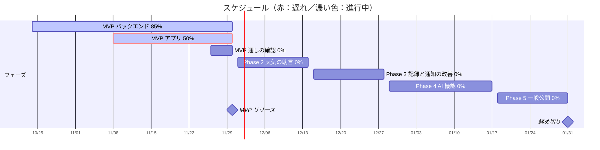

# uchinokusa（うちの草）

家族で共有できる、室内の観葉植物のお手入れ管理アプリ。

水やり・肥料・植え替えなどの予定を植物ごとに決めておくと、その日にやることが「今日」に並ぶ。家族のだれかが水やりを記録すると、ほかの人の画面にもすぐ反映されるので、水やりが重ならない。「今日は水やり不要」のように、やらないほうがよいことも示す。

- 株数の上限なし・無料で、家族で共同管理できることを目指している
- オーナー／編集者／閲覧者の権限で、家族を世帯に招待できる
- いまは MVP を作っている。天気と連動した助言や AI による識別は、MVP のあとのフェーズで足す（[ロードマップ](docs/roadmap.md)）

<!-- progress:start -->
### 進捗（2026-11-24 時点・自動更新）

**全体 40%（43/107）**　／　MVP リリース（2026-11-30）まで **あと 6 日**　／　締め切り（2027-01-31）まで **あと 68 日**

| フェーズ | 期間 | 進捗 | 期間の経過 | 状態 |
| --- | --- | --- | --- | --- |
| MVP：バックエンド | 10/24〜11/30 | `█████████░` 85%（33/39） | 84% | 🟢 順調 |
| MVP：アプリ | 11/08〜11/30 | `█████░░░░░` 50%（10/20） | 74% | 🔴 遅れ気味 |
| MVP：通しの確認 | 11/26〜11/30 | `░░░░░░░░░░` 0%（0/3） | 0% | ⏳ 開始前 |
| Phase 2：天気の助言 | 12/01〜12/14 | `░░░░░░░░░░` 0%（0/13） | 0% | ⏳ 開始前 |
| Phase 3：記録と通知の改善 | 12/15〜12/28 | `░░░░░░░░░░` 0%（0/13） | 0% | ⏳ 開始前 |
| Phase 4：AI 機能 | 12/29〜01/17 | `░░░░░░░░░░` 0%（0/11） | 0% | ⏳ 開始前 |
| Phase 5：一般公開 | 01/18〜01/31 | `░░░░░░░░░░` 0%（0/8） | 0% | ⏳ 開始前 |



> 進捗は [tasks.md](.kiro/specs/household-plant-care-mvp/tasks.md) と [docs/roadmap.md](docs/roadmap.md) のチェックボックスの数から計算している（作業量の重みは付けていない）。期間の経過より 20 ポイント以上遅れると「遅れ気味」。期間は [docs/progress/schedule.json](docs/progress/schedule.json)。
<!-- progress:end -->

## 構成

| 場所                                   | 中身                                                           |
| -------------------------------------- | -------------------------------------------------------------- |
| [`mobile/`](mobile/)                   | アプリ（React Native + Expo、Expo Router、TanStack Query）     |
| [`server/`](server/)                   | API サーバー（Go、PostgreSQL、WebSocket、定期ジョブ）          |
| [`api/openapi.yaml`](api/openapi.yaml) | API の仕様（唯一の正。サーバーとアプリの型はここから生成する） |
| [`.kiro/`](.kiro/)                     | 仕様駆動開発の仕様（要件・設計・タスク）とステアリング         |
| [`docs/decisions/`](docs/decisions/)   | 設計や運用の判断の記録                                         |
| [`docs/design/`](docs/design/)         | デザインの基礎（トークン・部品）と画面の一覧                   |
| [`docs/learning/`](docs/learning/)     | 開発の中で調べたことのまとめ                                   |

認証は Firebase Auth（Apple / Google のサインイン）、プッシュ通知は FCM。本番は Cloud Run と Cloud SQL を予定している（[tech.md](.kiro/steering/tech.md)）。

## ローカルでの起動

1. PostgreSQL と Firebase Auth Emulator を起動し、API サーバーを動かす：[server/README.md](server/README.md) の「ローカルでの起動」
2. アプリを iOS シミュレーターかブラウザで動かす：[mobile/README.md](mobile/README.md)

## 開発の進め方

- 仕様駆動開発（Kiro 方式）で、要件 → 設計 → タスク の順に承認してから実装する。仕様は [`.kiro/specs/household-plant-care-mvp/`](.kiro/specs/household-plant-care-mvp/)
- バックエンドとアプリは、別々の Claude Code のエージェントが並行して進める。引き継ぎは [HANDOFF.md](HANDOFF.md)（バックエンド）と [HANDOFF-mobile.md](HANDOFF-mobile.md)（アプリ）
- 上の進捗は、コミットのときに自動で更新する。クローンしたら、一度だけフックを有効にする：

  ```sh
  git config core.hooksPath .githooks
  ```

  - tasks.md・[docs/roadmap.md](docs/roadmap.md)・[docs/progress/schedule.json](docs/progress/schedule.json) を含むコミットで、[scripts/update-progress.mjs](scripts/update-progress.mjs) が README の進捗の区間を書き直し、コミットに含める
  - 手で更新するときは `node scripts/update-progress.mjs`
