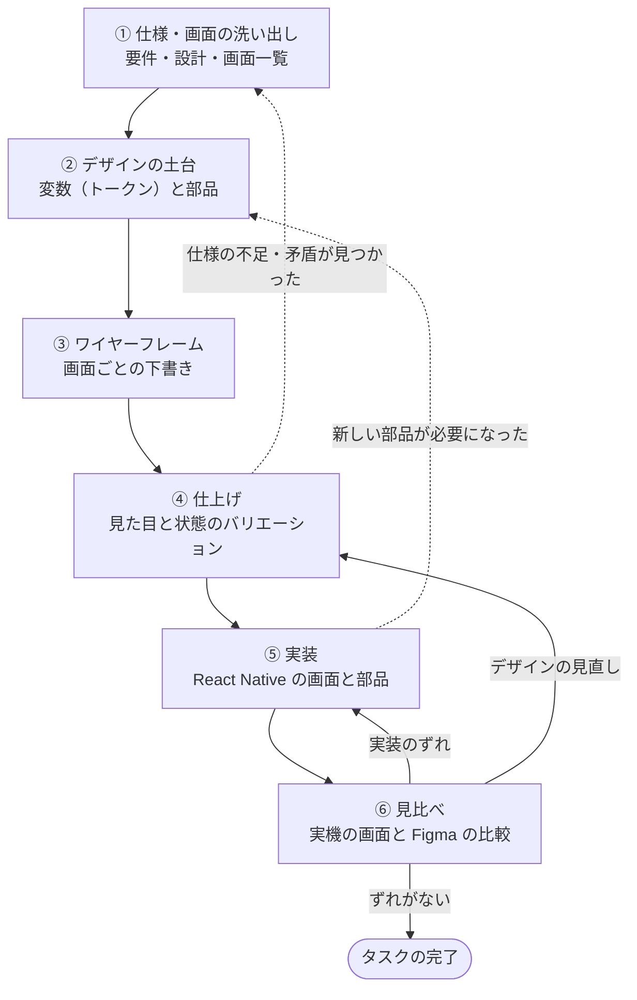
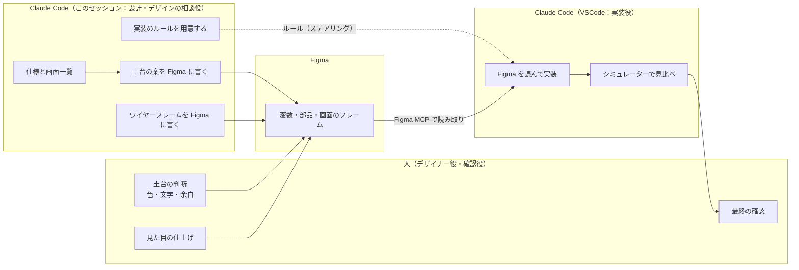
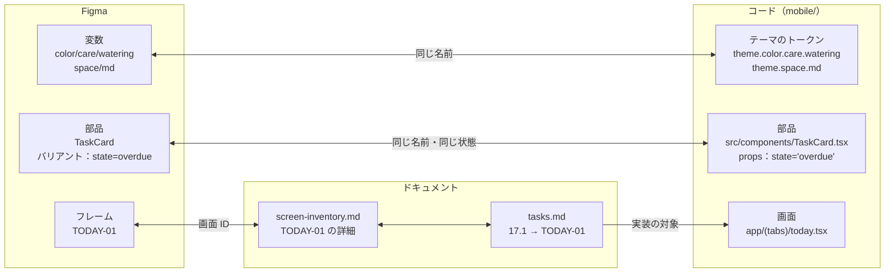
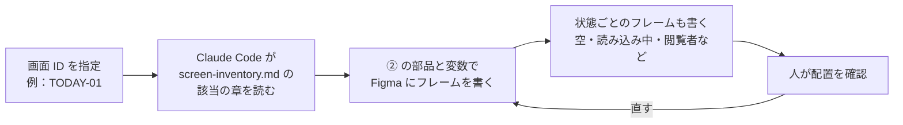
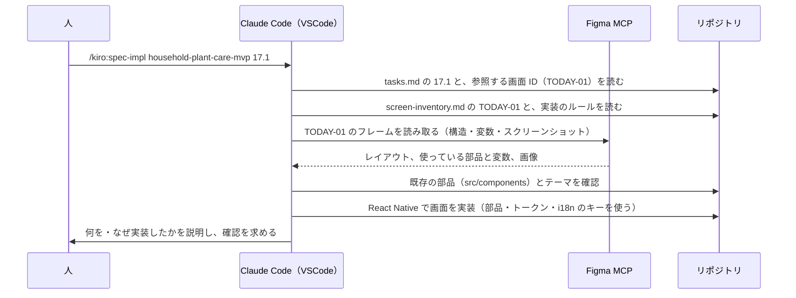
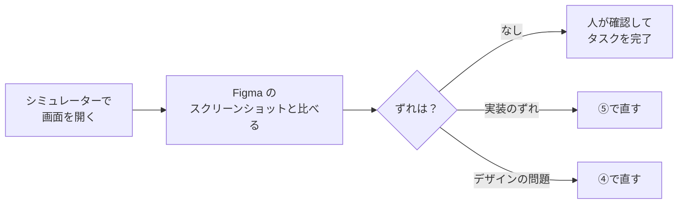
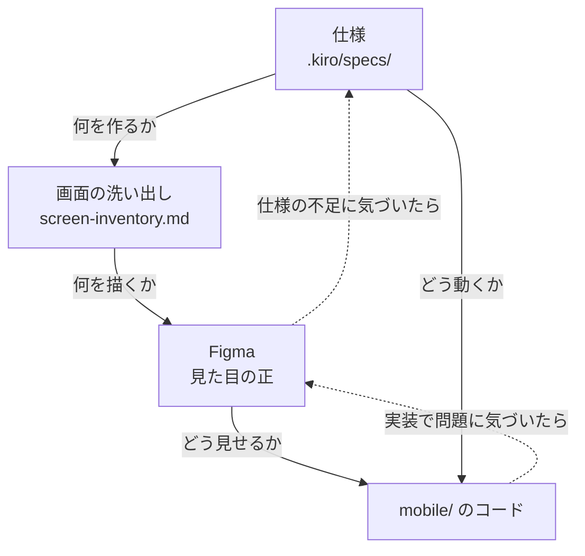

# デザインからフロントエンドの実装までの流れ

- 作成日：2026-10-31
- 目的：Claude Code と Figma（Figma MCP サーバー）を使って、仕様 → デザイン → 実装を、情報を落とさずに引き継ぐための進め方を決める
- 関連：`docs/design/screen-inventory.md`（画面・部品・挙動の洗い出し）、`.kiro/specs/household-plant-care-mvp/tasks.md`（タスク 14〜19 がフロントエンド）、`docs/design/decisions/`（デザインの判断の記録）
- **守るルール**：このドキュメントの方針のうち、作業のたびに守るものは `.kiro/steering/design.md` にまとめ、Claude Code が必ず読むようにしている

---

## 1. 全体の流れ

| | 工程 | 主な担当 | 道具 | 成果物 | 状態 |
|---|---|---|---|---|---|
| ① | 仕様・画面の洗い出し | Claude Code（このセッション） | Kiro の仕様 | `.kiro/specs/`、`docs/design/screen-inventory.md` | 済み |
| ② | デザインの土台 | 人 ＋ Claude Code | Figma（書き込み） | Figma の変数・部品、`mobile/src/theme` の定義 | これから |
| ③ | ワイヤーフレーム | Claude Code → Figma | Figma MCP（write to canvas） | 画面 ID ごとのフレーム | これから |
| ④ | 仕上げ | 人 | Figma | 完成したフレームとバリアント | これから |
| ⑤ | 実装 | Claude Code（VSCode） | Figma MCP（読み取り）、`/kiro:spec-impl` | `mobile/` のコード | これから |
| ⑥ | 見比べ | Claude Code（VSCode）＋ 人 | シミュレーター、Figma のスクリーンショット | 修正、タスクの完了 | これから |

---

## 2. 担当の分け方

- **このセッション**は、仕様の整理と Figma への書き込み（下書き）を担当する。実装のファイルは触らない。
- **VSCode のセッション**は、Figma を読み取って実装する。どちらのセッションにも Figma MCP を設定する。
- **人**は、デザインの判断（好み・使いやすさ）と、各工程の承認を担当する。Claude が書いた下書きは、必ず人が見直す。

---

## 3. 名前をそろえる（引き継ぎの質を決めるルール）

Figma とコードで同じ名前を使うと、Claude が「この Figma の要素は、コードのどれか」を推測しなくて済む。

| 対象 | Figma での名前 | コードでの名前 | 決めごと |
|---|---|---|---|
| 色 | `color/care/watering` | `theme.color.care.watering` | 区切りの `/` を `.` に読み替える |
| 余白・角丸・文字 | `space/md`、`radius/lg`、`text/body` | `theme.space.md` など | 生の値（`#4A90D9`、`16`）をコードに書かない |
| 部品 | `TaskCard` | `TaskCard`（`src/components/`） | 名前は `screen-inventory.md` の5章にそろえる |
| 部品の状態 | バリアントのプロパティ `state=overdue` | props の `state="overdue"` | プロパティ名と値も同じにする |
| 画面 | フレーム名 `TODAY-01` | `screen-inventory.md` の ID | 状態違いは `TODAY-01/empty` のように後ろに足す |
| 文言 | 実際の日本語 | `ja.json` のキー | Figma の文字列は例として扱い、コードに直書きしない |

---

## 4. 各工程の方針

### ① 仕様・画面の洗い出し（済み）

| 項目 | 内容 |
|---|---|
| 入力 | 要件定義書・設計書・タスク、`api/openapi.yaml`、DB のスキーマ |
| 出力 | `docs/design/screen-inventory.md`（41画面、共通部品、横断的な挙動、未決事項） |
| 方針 | 画面ごとに「表示する要素・操作・状態・要件の番号」を書く。仕様にない判断は【未決】として残す |
| 完了の条件 | 要件の受け入れ基準のうち、画面に関わるものがすべて、どこかの画面に対応している |

### ② デザインの土台

| 項目 | 内容 |
|---|---|
| 入力 | `screen-inventory.md` の5章（共通部品）・8章（列挙値）・10章（未決事項の22〜24） |
| 出力 | Figma の変数と部品のライブラリ |
| 方針 | **先に土台、あとで画面**。画面から作り始めると、同じような部品が少しずつ違う形で増える |
| 方針 | **OS に共通の UI は OS の標準部品（iOS は HIG）に任せ、アプリ固有の UI だけをデザインシステムで作る**（`docs/design/decisions/0001`）。Figma では、OS の層に Apple 公式の iOS の UI キットを使う |
| 方針 | 作業の種類（5種類）は、色とアイコンの両方で区別する（色だけに頼らない） |
| 方針 | 文字の大きさとボタンの大きさは、親世代が使うことを前提に余裕をもたせる（タップの領域は 44pt 以上） |
| 方針 | ライトモードとダークモードを変数のモードで分けるかを、ここで決める |
| 完了の条件 | 洗い出しの部品のうち、③で使うものが Figma にそろい、状態がバリアントになっている |

### ③ ワイヤーフレーム

| 項目 | 内容 |
|---|---|
| 入力 | `screen-inventory.md` の4章（画面ごとの詳細）、②の部品 |
| 出力 | 画面 ID ごとのフレーム（低い精度で、配置と情報の優先順位がわかればよい） |
| 方針 | Claude Code に書かせるのは **たたき台**。凝った見た目は④で人が仕上げる |
| 方針 | 新しい図形を描かず、②の部品を並べる（部品とつながったまま④・⑤へ進める） |
| 方針 | フレームはオートレイアウトで作り、レイヤーに意味のある名前をつける（⑤の読み取りの精度が上がる） |
| 方針 | 端末の大きさは 393 × 852（iPhone の標準的な大きさ）を基本にする |
| 注意 | Figma への書き込み（write to canvas）は新しい機能で、下書き以外のファイルに書くには Full シートが必要 |
| 完了の条件 | 対象の画面と、その状態（洗い出しの「状態」の項目）のフレームがそろっている |

### ④ 仕上げ

| 項目 | 内容 |
|---|---|
| 入力 | ③のフレーム |
| 出力 | 実装に渡せるフレーム |
| 方針 | 見た目の判断は人が行う。迷った点は、このセッションで相談する |
| 方針 | 仕上げの途中で仕様の不足や矛盾が見つかったら、①に戻して `screen-inventory.md` や仕様を直す（Figma だけを直さない） |
| 方針 | 新しい部品が必要になったら、②に戻して部品として作る（画面の中で一時的に作らない） |
| 完了の条件 | 画面ごとに、⑤で必要な状態がすべてそろい、人が承認している |

### ⑤ 実装

| 項目 | 内容 |
|---|---|
| 入力 | `tasks.md` のタスクと、参照する画面 ID、Figma のフレーム、実装のルール |
| 出力 | `mobile/` のコードとテスト |
| 方針 | Figma MCP が返すコードの例は Web 向け（React + Tailwind）なので、**そのまま使わず React Native に置き換える** |
| 方針 | 色・余白・文字の大きさは、テーマのトークンから使う。生の値は書かない |
| 方針 | `src/components` にある部品を優先して使う。ない場合は、②の部品と同じ名前で作る |
| 方針 | 文言は `ja.json` のキーから引く（要件20-7） |
| 方針 | 1タスクずつ進め、「何を・なぜ」を説明して確認をもらう（CLAUDE.md のルール） |
| 完了の条件 | タスクの要件を満たし、テストが通り、⑥の見比べでずれがない |

**実装のルール**（`.kiro/steering/design.md` に置き、VSCode のセッションが毎回読むようにしている）の主な内容：

- Figma のコードの例を React Native の部品（`View`、`Text`、`Pressable` など）に置き換える
- 色・余白・文字は、テーマのトークンを使う
- 既存の部品を優先して使う
- OS の層にあたるもの（タブバー、アラート、日付の選択など）は、Figma で iOS の見た目に描かれていても OS の標準部品で実装する
- 文言を直書きしない
- 閲覧者・空・読み込み中・エラーの状態も、Figma のフレームを見て作る

Figma MCP には、このようなルールのたたき台を作る機能（`create_design_system_rules`）がある。

### ⑥ 見比べ

| 項目 | 内容 |
|---|---|
| 方針 | 状態ごと（空・閲覧者・期限切れなど）に比べる。通常の状態だけで終わらせない |
| 方針 | 実機の画面で初めて気づいた問題（文字があふれる、押しにくいなど）は、Figma の側も直す。Figma とコードの内容をずらさない |
| 方針 | iOS と Android の両方で確認する（要件20-6） |

---

## 5. 仕様・デザイン・実装のどれかが変わったとき

正しい内容が書いてある場所（正）を決めておき、変更はいつも正から流す。

| 何が正か | 正の置き場所 |
|---|---|
| 何を作るか・どう動くか | `.kiro/specs/`（要件・設計） |
| どんな画面・状態があるか | `docs/design/screen-inventory.md` |
| どう見せるか | Figma |
| API の形 | `api/openapi.yaml` |

---

## 6. 準備

| 手順 | 内容 |
|---|---|
| 1 | Figma の公式の Claude Code プラグインを入れる（MCP の設定と、書き込みのためのスキルがまとめて入る）。手で設定する場合は `claude mcp add --transport http figma https://mcp.figma.com/mcp` |
| 2 | Claude Code で `/mcp` を開き、Figma にログインする |
| 3 | Figma のプランとシートで、書き込み（下書き以外は Full シート）を使えるかを確認する |
| 4 | VSCode のセッションにも、同じ MCP を設定する |
| 5 | Figma のファイルを作り、URL を `screen-inventory.md` に書いておく |
| 6 | 部品がそろってきたら、Figma の部品とコードの部品を結びつける Code Connect を検討する（React Native への対応とプランの条件は、導入前に確認する） |

参考：
- [Claude Code and Figma: Set up the MCP server](https://help.figma.com/hc/en-us/articles/39888612464151-Claude-Code-and-Figma-Set-up-the-MCP-server)
- [Guide to the Figma MCP server](https://help.figma.com/hc/en-us/articles/32132100833559-Guide-to-the-Figma-MCP-server)
- [Figma MCP server（開発者向けドキュメント）](https://developers.figma.com/docs/figma-mcp-server/)
