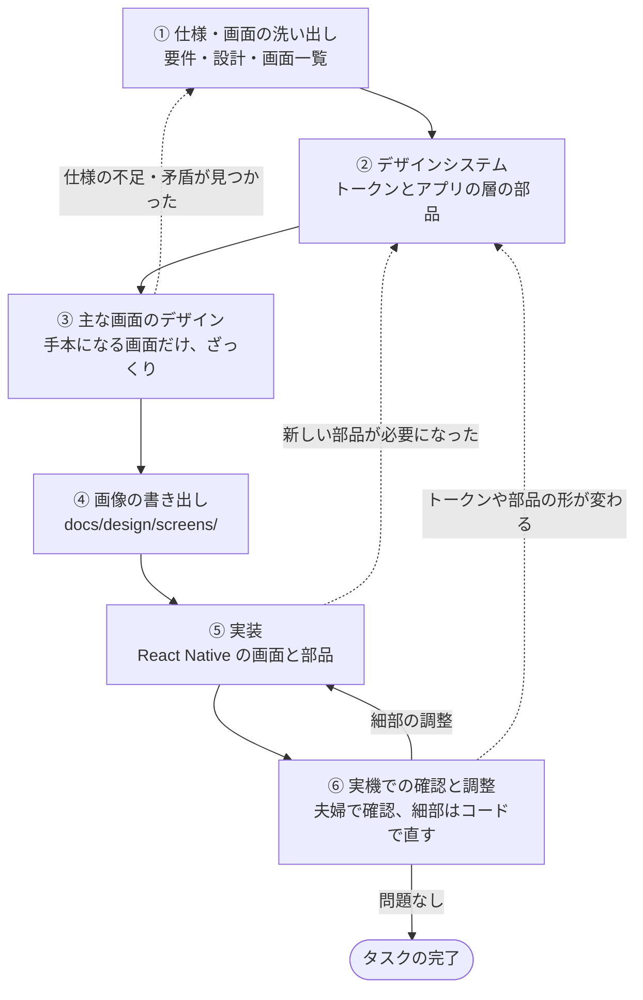
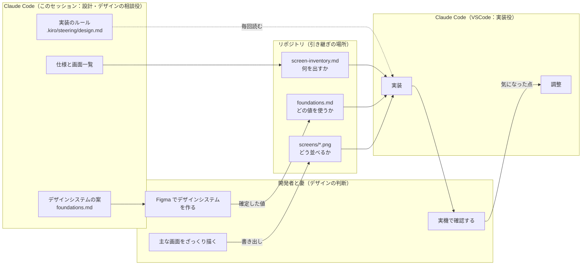
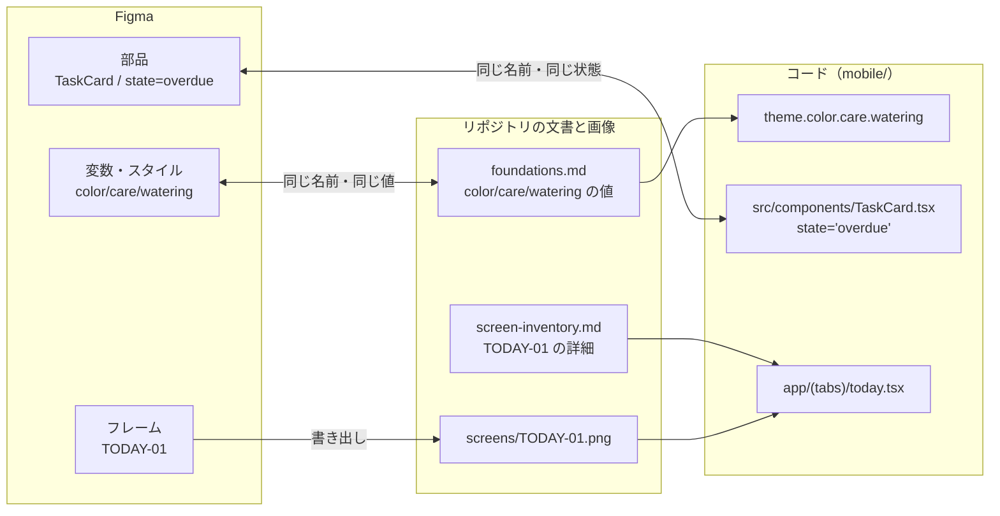
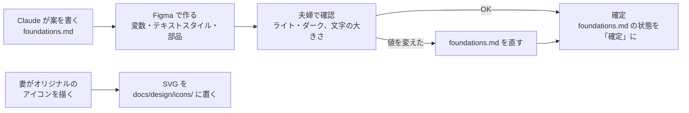
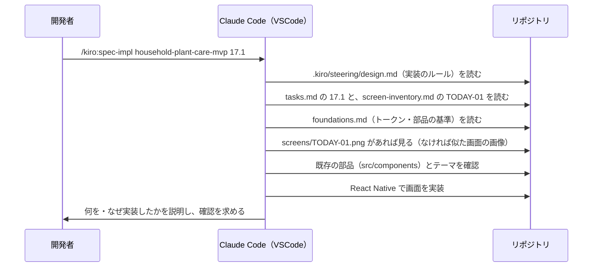
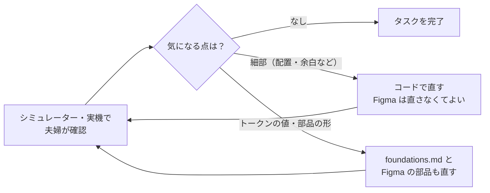
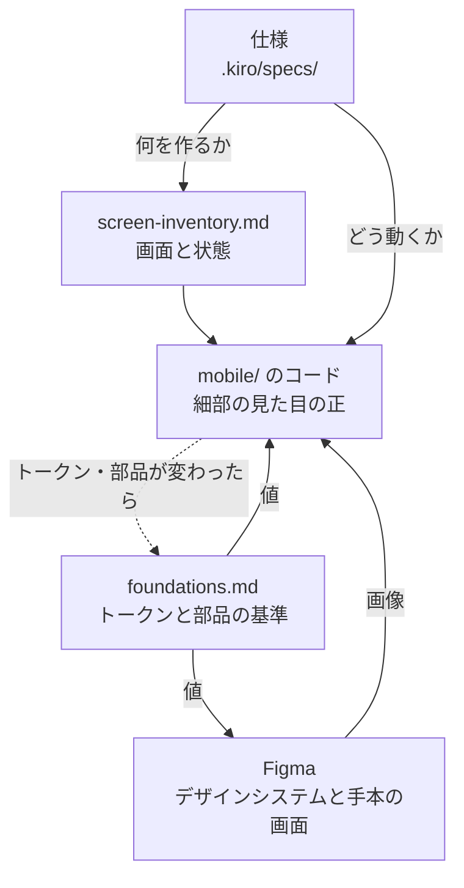

# デザインからフロントエンドの実装までの流れ

- 作成日：2026-10-31（2026-11-01 に、Figma の無料プランで進める形に改訂。理由は `docs/design/decisions/0003`）
- 目的：仕様 → デザイン → 実装を、情報を落とさずに Claude Code へ引き継ぐための進め方を決める
- 関連：`docs/design/screen-inventory.md`（画面・部品・挙動の洗い出し）、`docs/design/foundations.md`（トークン・アイコン・部品の基準）、`.kiro/specs/household-plant-care-mvp/tasks.md`（タスク 14〜19 がフロントエンド）、`docs/design/decisions/`（デザインの判断の記録）
- **守るルール**：このドキュメントの方針のうち、作業のたびに守るものは `.kiro/steering/design.md` にまとめ、Claude Code が必ず読むようにしている

## 基本の考え方
- **デザインはざっくり決め、細部は実装しながら実機で調整する**
- ただし **デザインシステムはきちんと作る**。描いていない画面も、デザインシステムのルールで同じ見た目にできるようにするため
- Figma は **無料プラン** で使う。Claude Code は Figma を直接は読み書きせず、**リポジトリの文書と、Figma から書き出した画像** で引き継ぐ

---

## 1. 全体の流れ

| | 工程 | 主な担当 | 道具 | 成果物 | 状態 |
|---|---|---|---|---|---|
| ① | 仕様・画面の洗い出し | Claude Code（このセッション） | Kiro の仕様 | `.kiro/specs/`、`screen-inventory.md` | 済み |
| ② | デザインシステム | Claude Code（案）→ 開発者と妻（Figma で作成・確認） | `foundations.md`、Figma（無料） | 確定した `foundations.md`、Figma の変数・部品、オリジナルのアイコン | 進行中 |
| ③ | 主な画面のデザイン | 開発者と妻 | Figma（無料） | 手本になる画面のフレーム | これから |
| ④ | 画像の書き出し | 開発者と妻 | Figma の書き出し | `docs/design/screens/*.png` | これから |
| ⑤ | 実装 | Claude Code（VSCode） | `/kiro:spec-impl` | `mobile/` のコード | これから |
| ⑥ | 実機での確認と調整 | 開発者と妻 ＋ Claude Code（VSCode） | シミュレーター、実機 | 修正、タスクの完了 | これから |

---

## 2. 担当と、引き継ぐもの

- **このセッション**は、仕様の整理、デザインシステムの案、実装のルールを担当する。実装のファイルは触らない
- **開発者と妻**は、Figma での作業と、デザインの判断を担当する
- **VSCode のセッション**は、リポジトリの3つ（`screen-inventory.md`、`foundations.md`、画像）を見て実装する
- Claude Code へ渡すものは、**すべてリポジトリに置く**。Figma にしかない情報は、Claude Code には見えない

---

## 3. 名前をそろえる

Figma とコードで同じ名前を使うと、画像や文書から「コードのどれか」を推測しなくて済む。

| 対象 | Figma | リポジトリ | コード |
|---|---|---|---|
| 色・文字・余白 | 変数・テキストスタイル `color/care/watering` | `foundations.md` の値（正） | `theme.color.care.watering`（`/` を `.` に読み替える） |
| 部品 | コンポーネント `TaskCard` | `screen-inventory.md` の5章、`foundations.md` の5章 | `src/components/TaskCard.tsx` |
| 部品の状態 | バリアント `state=overdue` | 同上 | props `state="overdue"` |
| 画面 | フレーム `TODAY-01`、`TODAY-01/empty` | `screens/TODAY-01.png`、`screens/TODAY-01/empty.png` | 画面のファイル |
| アイコン | コンポーネント `care-watering` | `docs/design/icons/care-watering.svg` | 同じ名前の SVG |
| 文言 | 実際の日本語 | — | `ja.json` のキー（直書きしない） |

---

## 4. 各工程の方針

### ① 仕様・画面の洗い出し（済み）

| 項目 | 内容 |
|---|---|
| 出力 | `docs/design/screen-inventory.md`（41画面、共通部品、横断的な挙動、未決事項） |
| 方針 | 画面ごとに「表示する要素・操作・状態・要件の番号」を書く。仕様にない判断は【未決】として残す |

### ② デザインシステム

| 項目 | 内容 |
|---|---|
| 入力 | `foundations.md`（案）、`screen-inventory.md` の5章 |
| 出力 | 確定した `foundations.md`、Figma の変数・テキストスタイル・部品、オリジナルのアイコンの SVG |
| 方針 | OS に共通の UI は OS の標準部品に任せ、アプリの層だけをデザインシステムで作る（`decisions/0001`）。Figma では OS の層に Apple 公式の iOS の UI キットを使う |
| 方針 | 一般的なアイコンは OS のシンボル、固有の概念のアイコンはオリジナル（`decisions/0002`） |
| 方針 | **値の正は `foundations.md`**。Figma で値を変えたら、必ず `foundations.md` も直す |
| 方針 | Figma の無料プランで変数のモードが1つしか使えない場合は、ライトの値だけを変数にし、ダークは `foundations.md` の値を実機で確認する |
| 完了の条件 | `foundations.md` が「確定」になり、優先1のアイコン（作業の種類・提案の種類）がそろっている（そろうまでは SF Symbols で仮置きしてよい） |

### ③ 主な画面のデザイン

| 項目 | 内容 |
|---|---|
| 入力 | `screen-inventory.md` の4章、②のデザインシステム |
| 出力 | 手本になる画面のフレーム |
| 対象（案） | `TODAY-01`（今日やること）、`PLANT-01`（植物の一覧）、`PLANT-10`（植物の詳細）、`TASK-01`（タスクの作成）、`AUTH-01`（サインイン）、`TODAY-03`（スキップのシート）。必要に応じて足す |
| 方針 | **全画面・全状態は描かない**。ほかの画面の手本になる配置と、情報の優先順位が分かればよい |
| 方針 | ②の部品を並べて描く。新しい部品が必要になったら、②に戻って部品として作る |
| 方針 | 状態は、見た目が大きく変わるもの（空の状態、閲覧者など）だけ描く |
| 方針 | 端末の大きさは 393 × 852 を基本にする |
| 方針 | 仕様の不足や矛盾に気づいたら、①に戻して仕様と `screen-inventory.md` を直す |

### ④ 画像の書き出し

| 項目 | 内容 |
|---|---|
| 出力 | `docs/design/screens/<画面 ID>.png`、状態違いは `docs/design/screens/<画面 ID>/<状態>.png` |
| 方針 | Figma のフレーム名を画面 ID にしておけば、そのまま書き出せる（フレーム名の `/` はフォルダになる） |
| 方針 | 倍率は 2x、形式は PNG |
| 方針 | デザインを変えたら、画像も書き出し直す |

### ⑤ 実装

| 項目 | 内容 |
|---|---|
| 入力 | `screen-inventory.md`（何を出すか）、`foundations.md`（どの値を使うか）、画像（どう並べるか） |
| 方針 | 画像から読み取った見た目は、**最も近いトークンに置き換える**。画像から測った生の値（`15px` など）を書かない |
| 方針 | 画像がない画面は、デザインシステムと、似た画面の画像にならう |
| 方針 | OS の層にあたるもの（タブバー、アラート、日付の選択など）は、画像で iOS の見た目に描かれていても OS の標準部品で実装する |
| 方針 | `src/components` にある部品を優先して使う。ない場合は、デザインシステムの部品と同じ名前で作る |
| 方針 | 文言は `ja.json` のキーから引く（要件20-7） |
| 方針 | 1タスクずつ進め、「何を・なぜ」を説明して確認をもらう（CLAUDE.md のルール） |

### ⑥ 実機での確認と調整

| 項目 | 内容 |
|---|---|
| 方針 | ライトとダーク、端末の文字の大きさを変えた状態、閲覧者・空・エラーの状態も見る |
| 方針 | **細部の見た目の正はコード**。画面ごとの細かい調整は、Figma に戻さなくてよい |
| 方針 | トークンの値や部品の形が変わる調整は、`foundations.md` と Figma のデザインシステムにも反映する（ほかの画面にも効くため） |
| 方針 | iOS で確認する。Android 版の前に、Android でも確認する（要件20-6） |

---

## 5. 何が正か

| 何が正か | 正の置き場所 |
|---|---|
| 何を作るか・どう動くか | `.kiro/specs/`（要件・設計） |
| どんな画面・状態があるか | `docs/design/screen-inventory.md` |
| トークンの値・部品の基準 | `docs/design/foundations.md` |
| 画面のおおまかな見た目 | Figma（`docs/design/screens/` に書き出す） |
| 細部の見た目 | `mobile/` のコード（実機の画面） |
| API の形 | `api/openapi.yaml` |

---

## 6. 準備

| 手順 | 内容 |
|---|---|
| 1 | Figma（無料）でファイルを1つ作り、ページを「Foundations（変数・文字）」「Components（部品）」「Icons」「Screens（主な画面）」に分ける |
| 2 | Apple 公式の iOS の UI キット（Apple Design Resources）を Figma に取り込み、OS の層の部品として使う |
| 3 | `foundations.md` の値で、変数（色・余白・角丸）とテキストスタイルを作る |
| 4 | Figma のファイルの URL を `foundations.md` の冒頭に書いておく（人が参照するため） |

Figma MCP は使わない（`decisions/0003`）。将来、有料プランにした場合は、この流れを見直す。
